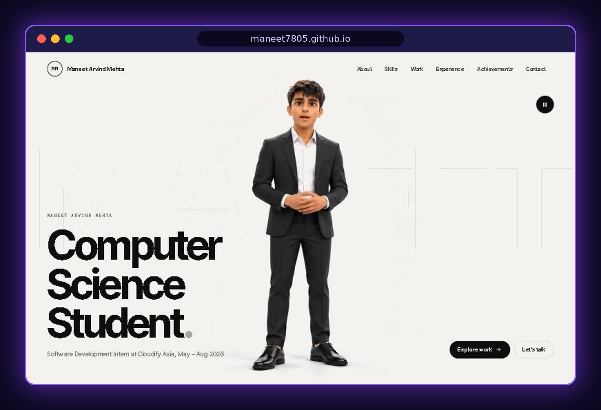
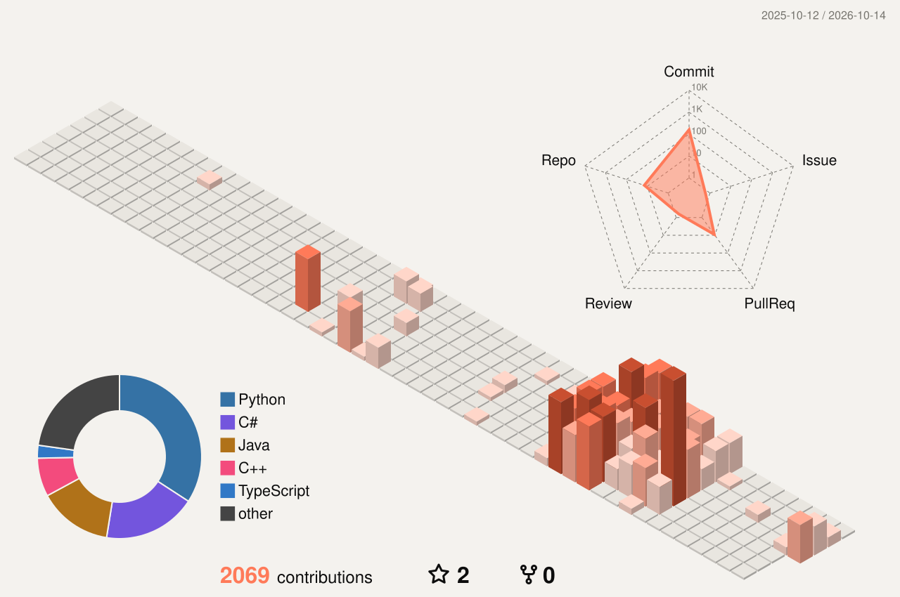

<h1 align="center">Maneet Arvind Mehta</h1>

  <picture>
    <source media="(prefers-color-scheme: dark)" srcset="https://readme-typing-svg.demolab.com?font=JetBrains+Mono&weight=500&size=20&duration=2800&pause=900&color=FF7A59&center=true&vCenter=true&width=680&lines=Software+engineer+%C2%B7+CS+%40+APU+%C3%97+De+Montfort;Shipped+a+production+CRM+as+an+intern;LLM+agents+with+controlled+tool+calling;Full-stack%3A+Next.js+%C2%B7+.NET+%C2%B7+PostgreSQL" />
    
  </picture>

  
  
  
  

  

  

  
  
  

---

## Tech Stack

  

<table>
  <tr><td><b>Languages</b></td><td></td></tr>
  <tr><td><b>Frontend</b></td><td></td></tr>
  <tr><td><b>Backend &amp; DB</b></td><td></td></tr>
  <tr><td><b>Cloud &amp; Tools</b></td><td></td></tr>
</table>

---|---|
| **Languages** |  |
| **Frontend** |  |
| **Backend & DB** |  |
| **Cloud & Tools** |  |

---

## GitHub Analytics

  
  

---

## GitHub Trophies

  

---

## Contribution Activity

  

---

## Contribution Snake

<picture>
  <source media="(prefers-color-scheme: dark)" srcset="https://raw.githubusercontent.com/Maneet7805/Maneet7805/output/github-snake-dark.svg" />
  <source media="(prefers-color-scheme: light)" srcset="https://raw.githubusercontent.com/Maneet7805/Maneet7805/output/github-snake.svg" />
  
</picture>

---

## Connect

  
  
  
  

---

<i>A feature isn't finished when it works. It's finished when people use it.</i>

