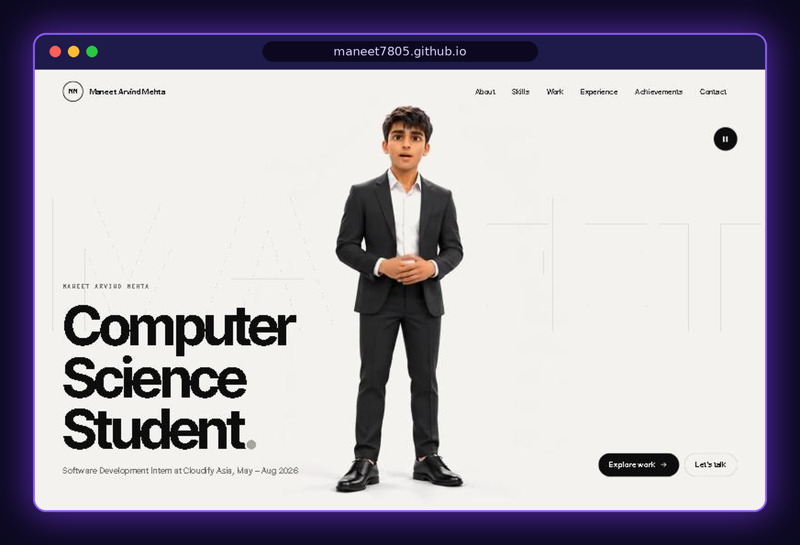
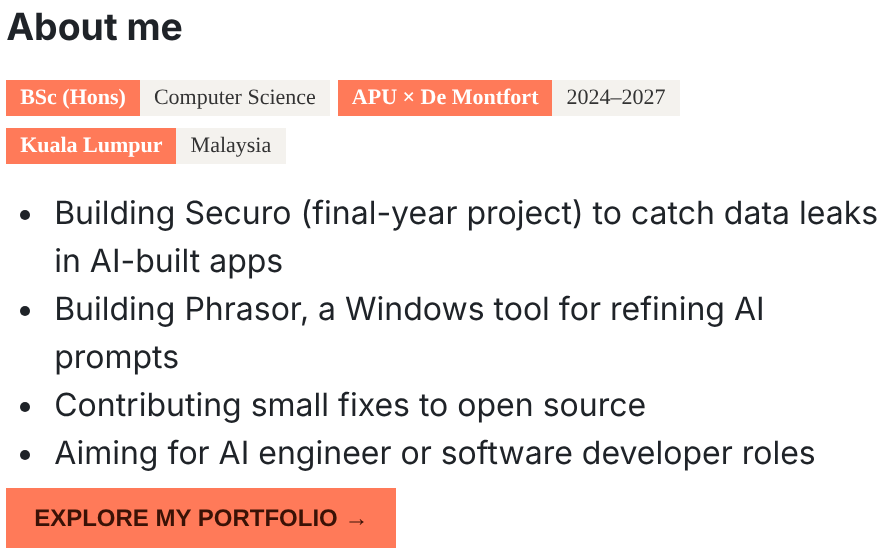
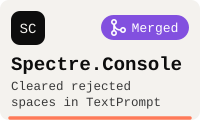
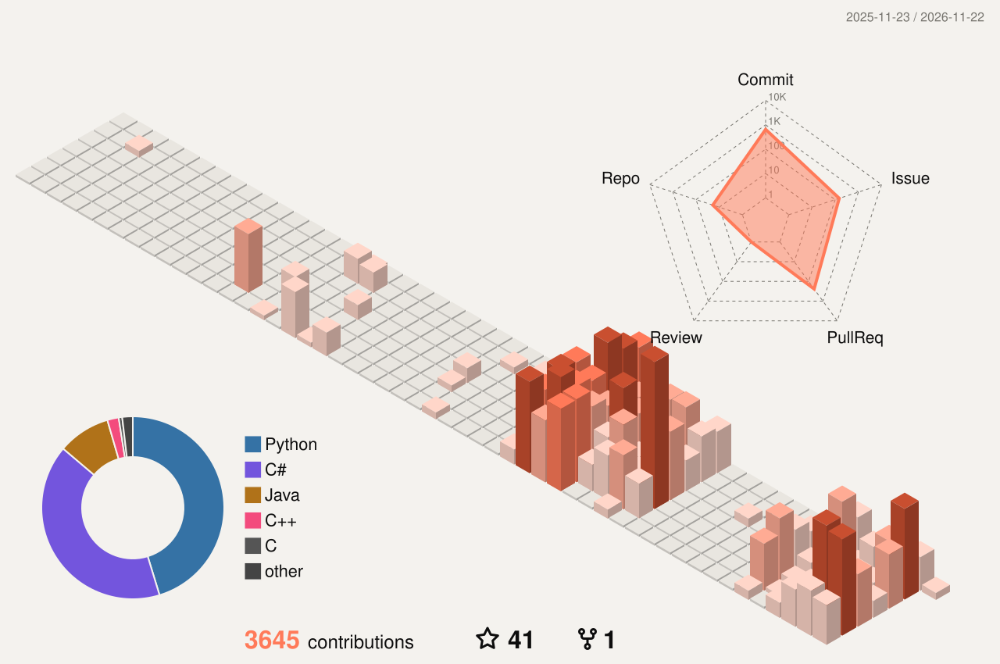

<h1 align="center">Maneet Arvind Mehta</h1>

  <picture>
    <source media="(prefers-color-scheme: dark)" srcset="https://readme-typing-svg.demolab.com?font=JetBrains+Mono&weight=500&size=20&duration=2800&pause=900&color=FF7A59&center=true&vCenter=true&width=680&lines=Software+engineer+%C2%B7+CS+%40+APU+%C3%97+De+Montfort;Shipped+a+production+CRM+as+an+intern;LLM+agents+with+controlled+tool+calling;Full-stack%3A+Next.js+%C2%B7+.NET+%C2%B7+PostgreSQL" />
    
  </picture>

  
  

  <a href="https://maneet7805.github.io"><picture><source media="(prefers-color-scheme: dark)" srcset="assets/about-dark.png" /></picture></a>

### Tech Stack

  

### Open Source Contributions

  
  

### GitHub Analytics

  
  

Streak card counts all contributions since Jan 2025; the calendar below shows the last 12 months. They update at different times, so the totals can differ slightly.

### Contribution Activity

  

Last 12 months &middot; refreshed daily

### Contribution Snake

<picture>
  <source media="(prefers-color-scheme: dark)" srcset="https://raw.githubusercontent.com/Maneet7805/Maneet7805/output/github-snake-dark.svg" />
  <source media="(prefers-color-scheme: light)" srcset="https://raw.githubusercontent.com/Maneet7805/Maneet7805/output/github-snake.svg" />
  
</picture>

### GitHub Trophies

  

---

### Connect

  
  
  

<i>A software isn't finished when it works. It's finished when people use it.</i>

